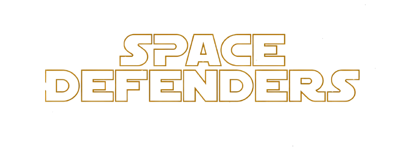
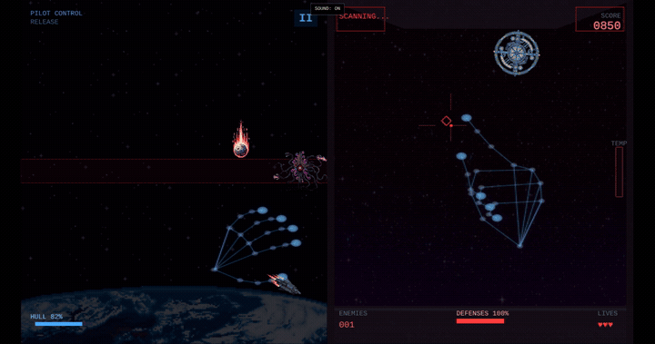

<p align="center">
  
</p>

# Space Defenders — 21st Century

A space shooter you play with both hands and a webcam. Fly through meteors and black holes on the left; aim and defend your ship on the right. Finger guns are part of the controls.

**[Play the game](https://spacedefenders.sanjaymalla.com/)** · **[Watch the trailer](https://youtu.be/lYjdcCrbLaQ)** · [Releases](https://github.com/sanjayBahadur/SPACE-DEFENDERS-21st-Century/releases)

I built Space Defenders to see whether hand gestures could carry an arcade game beyond a short demo. Getting a ship to follow your hand was the starting point. Making menus, firing, pauses and camera recovery feel consistent took most of the work.

## Watch it in action

[](https://youtu.be/lYjdcCrbLaQ)

*The trailer features Sanjay Malla and Masyn Akira Knight trying the game at USF.*



*Actual gameplay: the blue skeletons show what the camera is tracking. They stay visible to help you line up your hands.*

## How to play

Open the game on a desktop or laptop in landscape. Choose gesture controls and allow camera access, or use keyboard and mouse. There is a short briefing before each mission, and the pause screen keeps the gesture instructions nearby.

| Job | With your hands | With keyboard and mouse |
| --- | --- | --- |
| Fly the ship | Close your left hand to grab and move it; open to release | WASD or arrow keys |
| Aim and shoot | Point your right index finger; flick your thumb to fire | Mouse aim and left click |
| Fire the cannon | Make a right fist; watch the heat bar | Hold Space or right click |
| Navigate menus | Point with your right index and flick your thumb to select | Click buttons |
| Pause | Losing a tracked hand pauses the mission | Esc or P |

One player controls both stations. Losing either station ends the run. If tracking drops, bring both hands back to resume, or switch to keyboard and mouse. You can skip the opening crawl and change music, effects and hand-overlay settings from the menus.

Camera frames are processed in your browser and are not uploaded. Gesture controls need HTTPS or localhost. Touch controls are not implemented; camera performance depends on your device and lighting.

## What is under the hood

| Tool | What I use it for |
| --- | --- |
| **TypeScript** | Game logic, gesture interpretation, input state and shared UI controllers |
| **Phaser 3** | The two game views, sprites, animation, scene lifecycle, timers and combat input |
| **MediaPipe Hand Landmarker** | Detecting hand landmarks and handedness from webcam frames |
| **Browser APIs** | Camera access, the Canvas hand overlay, Web Audio effects and streamed music |
| **Vite** | Development server, production bundling and lazy loading of the vision library |
| **Node test runner + Playwright** | Logic regression tests and browser checks against the built game |
| **Cloudflare Pages** | Static hosting at the custom domain; gameplay and inference run on the visitor’s device |

MediaPipe finds the landmarks. The game decides what they mean: which hand controls which station, whether a fist is closed, when a thumb flick counts as a shot, and where the menu pointer belongs. There is no separately trained gesture model.

### The parts that needed care

- **Keeping aiming steady without making it sluggish.** A local implementation of the 1€ filter smooths small movements while responding faster to larger ones. Inference processes each new camera frame once; ship movement and cannon heat use elapsed time rather than frame counts. See [hand tracking](src/services/HandTracker.ts) and [input filtering](src/utils/OneEuroFilter.ts).
- **Making gestures work outside combat.** Home, pause and retry share a [gesture navigator](src/ui/GestureMenu.ts). A stable hover and fresh thumb flick confirm an action, so the flick used to start a mission does not also fire a shot. Pointer coordinates account for canvas scaling and letterboxing.
- **Recovering when the camera stops helping.** Camera access is opt-in, the vision library and models load on demand, and GPU initialization can fall back to CPU. Missing hands pause play; returning hands get a fresh motion baseline. Keyboard play avoids downloading the hand model entirely.
- **Cleaning up between runs.** Scene transitions release listeners, timers and active audio loops. Music and effects have separate saved controls; rapid effects have voice limits so a busy scene cannot create unlimited overlapping sounds.
- **Checking the build people actually play.** Browser checks cover menu and mission flows, denied-camera fallback, audio recovery, and real model/WASM startup with a synthetic camera. They catch integration failures, while physical gesture feel still needs real playtesting.

The artwork pipeline also converts the original images to lossless WebP and verifies decoded pixels. It reduced image downloads by **35.2%**, while keeping the original frame sizes and transparency. That saves transfer bytes, not decoded texture memory.

[Full technology guide](docs/technology.md) · [Audio design and sources](docs/audio.md) · [Asset provenance](docs/assets-and-models.md)

## Run locally

Use Node.js 22.12+ (Node 20.19+ also works).

```sh
npm ci
npm run dev
```

For a production build and checks:

```sh
npm test
npm run check
npm run build
node scripts/check-static-hosting.mjs
npx playwright install chromium
SMOKE_BASE_PATH=/ npm run test:browser
npm run preview
```

The smoke command starts and stops its own preview server. Tests use a synthetic camera stream to check model startup; they do not establish recognition accuracy for a real person. There is no separate linter configured.

Cloudflare serves the root-path build in `dist/`. GitHub Pages uses a separate build with `--base=/SPACE-DEFENDERS-21st-Century/`. The [release guide](docs/releasing.md) covers deployment, build artifacts and rollback.

## Credits

Created by **[Sanjay Malla](https://sanjaymalla.com/)** / [sanjayBahadur](https://github.com/sanjayBahadur).

Promotional video: **Masyn Akira Knight**. Beta testing: **Masyn Akira Knight, Jackson Poynor and Max**.

Music includes **“Space Marines” by Telaron** ([CC BY 3.0](https://creativecommons.org/licenses/by/3.0/)) and **“Out There” by yd** (CC0). Sound effects are from **Kenney** (CC0). [Audio credits](public/legal/audio-notices.txt) list sources and edits; [third-party notices](public/legal/THIRD-PARTY-NOTICES.txt) cover dependencies and are included in the distributed game.
